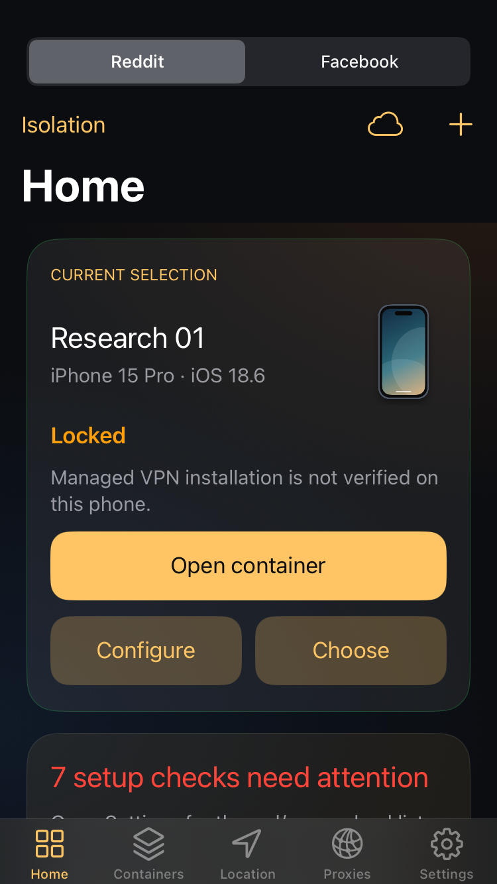
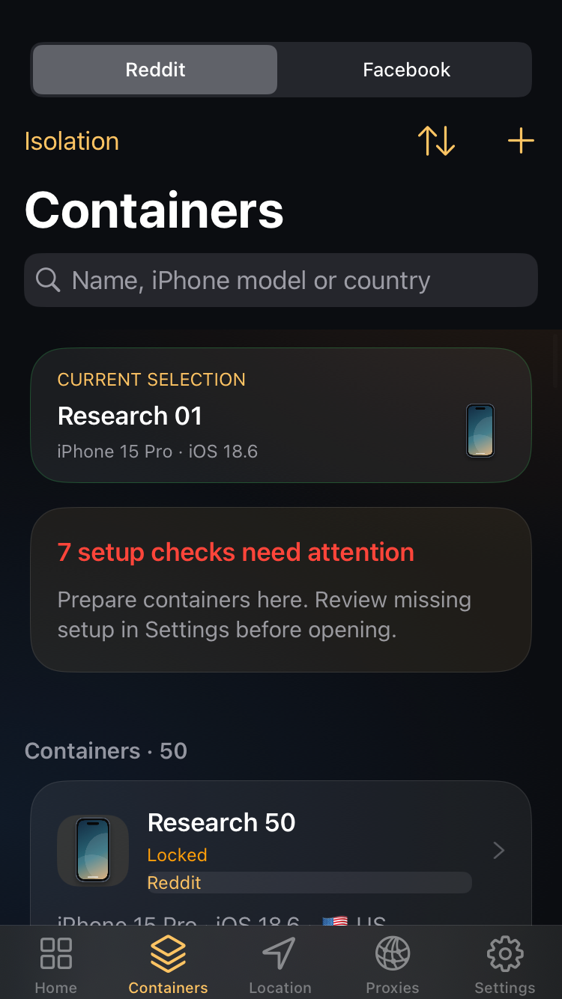
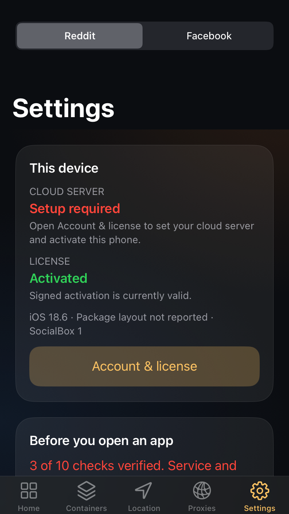

# SocialBox reference-flow candidate 0.1.36

Completed 2026-09-20 on `feat/socialbox-multiapp`, without merging. This is a
built interface/workflow candidate, **not a production release or certification
of device isolation**. Both packages are local; neither Sileo repository nor
the production Vercel app was changed by this pass. No phone was reinstalled.

## Implemented

All thirteen supplied screenshots were inventoried before implementation in
[the design and feature disposition](socialbox-reference-redesign.md). The
[interactive sketch](socialbox-reference-preview.html) is a proposal using
synthetic data; the images below are the actual native controllers.

- Five native destinations: Home, Containers, Location, Proxies and Settings.
  Dark amber/blue cards, local phone illustration, visible current selection,
  searchable container inventory and supported light appearance.
- Simple creation now starts from both Reddit entry points with a reversible
  preview: name, selected device proxy, complete automatic identity, review/edit,
  then explicit Create. Previewing does not install a clone or reserve identity.
  Expiry, source replacement, proxy/account changes and stale revisions prevent
  committing an obsolete preview. Final creation consumes its private token.
- Searchable compatible model/iOS, region, language/locale, carrier and city
  pickers. Existing identities retain their post-use lock and consistency rules.
- HTTP proxy list preview/import with semantic duplicate detection and a single
  secure-record update. Invalid input, stale review or failed persistence does
  not partly import. Import does not select a proxy or change Cloud assignments.
- Rename changes organizational metadata, not identity, installed app name,
  sandbox or account. Cloud revisions prevent stale changes. Previously offline
  containers can first publish an unchanged legacy long name without truncation.
- Settings distinguishes signed license validity, configured Cloud server and
  actual readiness. The Cloud web destination follows the selected app.

## Native visual evidence

These captures use production UIKit with inert IPC and synthetic fixture data
on an iOS 18.6 simulator at 375 × 667 points. The deliberately missing setup
remains visible. They do not show fifty installed apps or logged-in accounts.

A 37-second H.264 recording of the successful workspace regression is retained
outside Git at `private-device/socialbox-ui-2026-09-19/workspace-ui-fixture.mp4`
relative to the task workspace. It includes light/dark presentation and expected
blocked/invalid-input cases. Its hash and the screenshot hashes are recorded in
the [machine-readable evidence](leak-surface/reference-ui-validation-2026-09-19.json).

## Validation

- **PASS:** complete `scripts/build-mac.sh` for rootless and rootful, each with
  135 host/native check entry points; existing Reddit regression entry points
  are listed individually in the evidence JSON. No checks were disabled.
- **PASS:** unsigned Xcode archives, Procursus ldid signing, both Debian package
  inspections and byte-identical existing public license pin. No Apple team.
- **PASS:** full Cloud `npm test`, TypeScript, static check and diff check.
- **PASS:** actual UIKit workspace 216, identity editor/pickers 198, creation
  wizard 26 and proxy importer 20 assertions. These are separate fixtures, not
  independent measurements of isolation.
- **PASS:** draft preparation 57, private draft store 45, actual dispatch 234,
  source binding 62, native proxy import 45, rename registry 55 and Cloud
  metadata 14 grouped checks. Full regressions also cover forty-target selection,
  recovery, deletion, backup, keychain, firewall, license and User-Agent behavior.
- **PASS:** current 381-row leak-surface contract and source snapshot; trailer
  gate for the later corrective commits since `37dee97`.
- **FAIL — process issue:** the first six implementation commits omitted the
  required `Leak-Surface:` trailers. Exact commit-to-row mappings are now in the
  evidence JSON. The historical gate from `f89f541` still fails. No remote
  history was rewritten and the gate was not weakened.
- **NOT_RUN:** physical installation/upgrade of this candidate, forty real
  sandboxes/canaries, account logins, proxy outage/network-change/reboot traffic
  capture and cross-phone credential continuity.

## Packages

Local package files are under `packages/` (build outputs, not committed):

- `com.redditbox_0.1.36_iphoneos-arm64.deb` — rootless, 2,164,852 bytes.
  SHA-256 `af6b28284ff77730600318887d143eca20c924d788dbe7133c127fc3d19fa83e`.
- `com.redditbox_0.1.36_iphoneos-arm.deb` — rootful, 2,155,122 bytes.
  SHA-256 `d30d42444b0cab20e55bf5058c5be36622e5a81734c74b0d070f4463c09c6a63`.

Both packages explicitly have `requiresMDMReadoption=true`. Installation alone
does not establish the clone's managed-VPN association or effective routing.
Do not replace the public license pin or treat an old successful network check
as acceptance of this candidate. The existing staged release/publisher-lock
procedure remains required before APT/production publication.

## Remaining functional limits

The screenshot reference's original-app storage-switching and personal VPN
engine were not substituted for SocialBox's independent clones and managed
app-proxy provider. Original App Store Facebook/Reddit icons still open the
original apps. No-MDM online confinement is not implemented; missing/unverified
network enforcement continues to block Open. Facebook remains inactive pending
its required binary/runtime/lifecycle acceptance.

Saved device proxies and actual per-container Cloud assignments remain distinct.
The reference's one-tap per-container proxy linking, multi-app grouping,
folders/manual order, QR/Shadowrocket imports, generation ranges/pins and
system-wide location simulation are not advertised as implemented. The design
document gives a disposition for each screenshot control. Broad system cleanup,
global Settings spoofing and session-token extraction were not added.

The isolation ledger still contains **31 gaps and 170 unverified rows**; its
180 covered-in-code rows are not a runtime guarantee. No existing unresolved
verdict was marked complete merely because the UI or host tests passed.

## Commit units

Implementation commits: `d4a3bbe` preparation; `545aff4` proxy import;
`5339cb5` native shell and initial design; `e7c7665` private reviewed creation;
`194cb80` setup/Cloud; `37dee97` searchable pickers; `1384d59` source/authority
hardening; `f5233a5` Rename and legacy Cloud compatibility; `ab0a8fc` Reddit
wizard entry and UI evidence; `9aa6bec` Mac regression integration.

The final documentation commit records this handoff, the regenerated inventory
and native screenshots. All work stays on the feature branch.
